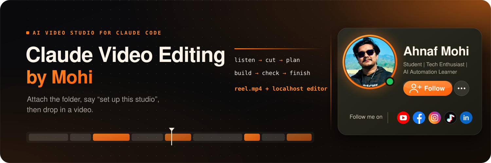
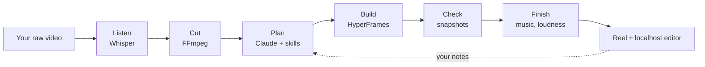

<p align="center"></p>

<p align="center"><b>Follow me for more AI video editing tutorials, new versions of this studio, and behind-the-scenes edits</b></p>

<p align="center">
  <a href="https://www.youtube.com/@ahnafmohi"></a>
  <a href="https://www.facebook.com/ahnafmohi71"></a>
  <a href="https://www.instagram.com/ahnaf.mohi/"></a>
  <a href="https://www.tiktok.com/@ahnaf.mohi"></a>
  <a href="https://www.linkedin.com/in/al-mamun-b97255265/"></a>
</p>

<p align="center">Made something with it? Tag me, I would love to see it. Found a bug or have an idea? Open an issue.</p>

# Claude Video Editing by Mohi

**Drop in a raw video. Claude Code cuts it, adds Bangla captions, animations and sound, and hands back a finished reel.
Then you fine-tune it in a local editor by dragging, or by telling Claude what to change.**

> Attach this folder to Claude Code, say **"set up this studio"**, and you're ready to edit.

It is a complete, self-teaching studio: an editing **engine**, a locked house **style**, and a set of Claude **skills**
that hold everything learned from real edits. The more you use it, the more it adapts to you (say *"save this to the
skill"* and it remembers).

## What it does

- **Listens** to your video (Whisper: Bangla and English), finds every word and its exact time.
- **Cuts** pauses, fillers and retakes. Cleans the voice. Keeps your best take.
- **Plans** a graphic for each idea you speak: when you say "sound effect" it shows and plays one; each time you say
  "animation" it shows a different animation; titles sit on glossy cards **behind your head**.
- **Builds** it with [HyperFrames](https://github.com/heygen-com/hyperframes) (animations are real HTML), adds Bangla
  captions (Hind Siliguri), zooms, sound and music, and renders a 1080×1920 reel at a proper loudness.
- **Lets you adjust** it in a localhost editor, or by comments like *"at 6 s make the card smaller"*.

## Quick start

1. **Get Claude Code** (the Claude desktop app, code tab). You need a **paid** Claude plan. Video editing uses many
   tokens, so start with a short clip.
2. **Get this folder:** `git clone https://github.com/YOUR-USERNAME/claude-video-editing-by-mohi.git`
   (or *Code → Download ZIP*), then open the folder in Claude Code: **Local**, this folder, **Permissions: Auto**,
   newest model.
3. **Say:** `Set up this studio.` Claude installs and checks everything itself (about 20 to 40 minutes, mostly
   downloads), then runs a test video. On a Mac it may ask you to run one line for Homebrew, because that step needs
   your password.
4. **Edit:** `Edit this video: /path/to/your-clip.mov`. Claude shows you the script first, then the plan, then renders
   and gives you the localhost editor link.

Prefer to do it by hand, one tool at a time? Open [`docs/index.html`](docs/index.html), a step-by-step lesson with one
copy-paste per tool. More in [SETUP.md](SETUP.md).

## How it works



## What you need

| | |
|---|---|
| Computer | **Apple Silicon Mac** (M1 or newer) is the tested path. Windows, Intel Mac and Linux are supported but **experimental**: Claude adapts the setup, and the transcriber switches to `faster-whisper` automatically. |
| Claude Code | Desktop app with a paid plan |
| Space | About 20 GB free (the Bangla speech model alone is about 3 GB) |
| Internet | To download tools and models once |

## What's in this folder

```
CLAUDE.md          read automatically by Claude Code: what this studio is and how to behave
SETUP.md           how setup works, manual steps, troubleshooting
TRAINING-GUIDE.md  how to teach Claude your own style
.claude/skills/    claude-video-editing (entry point) · setup-studio · video-edit · rough-cut · graphics-plan
                   background-music · review-gate · thumbnail-generator · text-to-video · to-premiere · study-reference
engine/            the editing engine (roughcut, build, finalize, matte, transcribe, track), fonts, templates
presets/           the locked house style (colours, captions, Bangla spelling fixes)
scripts/           new-job, render, finalize · doctor.py, setup_assets.py, make_sfx.py
docs/index.html    hands-on lesson page: install everything yourself, tool by tool
projects/          one folder per video (an example job is included)
raw/  exports/     your footage in, finished files out (never committed)
```

## Make it yours

Tell Claude what you like or don't, in plain words, right after an edit (*"captions are too big"*, *"never cover my
face"*). Add **"from now on"** and it writes the rule into the right skill, so every future video follows it. Drop
screenshots or clips of edits you admire into `style-references/` and say *"study style-references"*. Details in
[TRAINING-GUIDE.md](TRAINING-GUIDE.md).

## Not included, on purpose

- **Music.** No tracks ship (licences). Add your own to `music/`, or ask Claude for free CC0 loops.
- **Third-party sound packs.** Setup generates 24 original sound effects ([`scripts/make_sfx.py`](scripts/make_sfx.py)).
  Drop a better `.wav` with the same name into `engine/sfx/` and it wins.
- **Large downloads** (GSAP, the noise remover, speech models) are fetched during setup instead of stored here.

## Honest status

Built and used on an Apple Silicon Mac with Bangla talking-head reels. The cross-platform parts (Windows/Intel/Linux
setup, the `faster-whisper` fallback) were tested on a Mac CPU only, not on real Windows or Linux machines yet. If
something fails on your computer, Claude is instructed to fix the cause and continue, and issues and pull requests
are welcome.

## Credits and licences

Made by **Ahnaf Mohi**. Code is MIT ([LICENSE](LICENSE)). Fonts are SIL Open Font Licence, and the tools installed by setup
keep their own licences: see [THIRD-PARTY-NOTICES.md](THIRD-PARTY-NOTICES.md). Built on
[HyperFrames](https://github.com/heygen-com/hyperframes), FFmpeg, OpenAI Whisper, and Claude Code.
